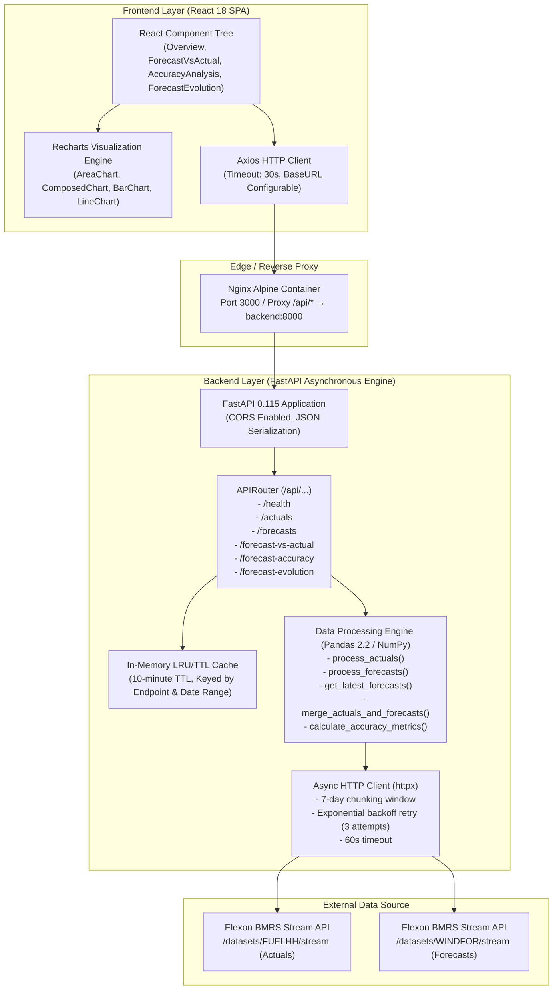
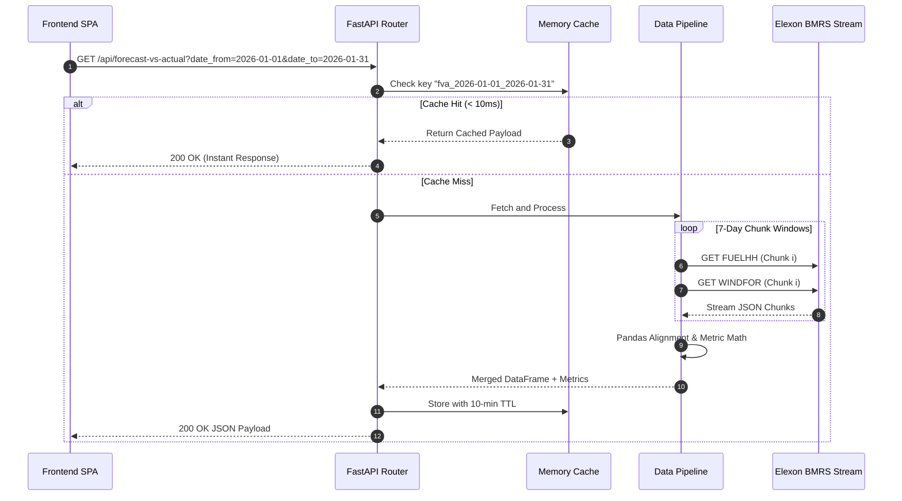

# Technical Architecture & Software Design Review

**System:** AEROPOW·UK — Wind Power Forecast Accuracy Platform  
**Target Audience:** Internal Technical Lead / Staff Software Architect  
**Review Type:** Codebase Design, Data Engineering Pipeline, & Production Readiness  
**Date:** October 2026 / Implementation Benchmark: January 2026  

---

## 1. System Overview & Architecture

AEROPOW·UK is designed as a decoupled, asynchronous micro-architecture comprising an asynchronous Python backend and a React 18 single-page application (SPA), containerized with Docker and Docker Compose.



---

## 2. Data Engineering & Ingestion Pipeline

### 2.1 Elexon BMRS Stream Ingestion
The application consumes two distinct datasets from the Elexon BMRS Insights API without requiring API key authorization:
* **FUELHH (`/datasets/FUELHH/stream`):** Half-hourly generation outturn by fuel type. Filtered on `fuelType=WIND`. Each record contains `startTime` (ISO-8601), `settlementDate`, `settlementPeriod` (1–48), and `generation` (MW).
* **WINDFOR (`/datasets/WINDFOR/stream`):** National wind generation forecasts published by the Electricity System Operator (ESO) up to 8 times daily (03:30, 05:30, 08:30, 10:30, 12:30, 16:30, 19:30, 23:30). Each record contains `publishTime`, `startTime`, and `generation` (MW).

### 2.2 Resilient Window Chunking & Retry Logic
Requesting a full month of half-hourly stream records in a single HTTP request routinely triggers Gateway Timeouts (504) or stream truncation on BMRS.
To solve this, `elexon_client.py` implements:
1. **7-Day Rolling Windows:** Large date ranges (such as January 1–31, 2026) are split into discrete 7-day chunk boundaries using `_date_windows()`.
2. **Publish Window Mapping:** Because day-ahead forecasts for January 1 are published on December 31, the query window for forecasts automatically starts `D-1`:
   $$\text{publishFrom} = \text{dateFrom} - 1\text{ day}$$
3. **Exponential Backoff:** If a network blip or rate limit occurs, `_fetch_with_retry` retries with exponential backoff ($2^0, 2^1, 2^2$ seconds).



---

## 3. Mathematical & Statistical Formulations

### 3.1 Point-in-Time Forecast Alignment (Latest Vintage Match)
In operational practice, the forecast available to traders closest to the day-ahead auction gate is the operative decision signal. 

For each target delivery interval $t$ (`startTime`), multiple forecasts $f(t, p)$ exist across different publication times $p$ (`publishTime`). The latest forecast is isolated by grouping on `startTime` and taking the maximum `publishTime`:
$$\hat{y}_t = f(t, \max(p) \mid p \le \text{Gate Closure})$$

In Pandas:
```python
idx = forecasts_df.groupby("startTime")["publishTime"].idxmax()
latest_forecasts = forecasts_df.loc[idx]
```

### 3.2 Accuracy Metrics Formulations
For $N$ settlement periods with actual generation $y_t$ and forecast $\hat{y}_t$:

1. **Mean Absolute Error (MAE):** Average error magnitude in Megawatts:
   $$\text{MAE} = \frac{1}{N}\sum_{t=1}^N |\hat{y}_t - y_t|$$

2. **Root Mean Square Error (RMSE):** Volatility penalty emphasizing severe forecast misses:
   $$\text{RMSE} = \sqrt{\frac{1}{N}\sum_{t=1}^N (\hat{y}_t - y_t)^2}$$

3. **Mean Bias Error (MBE):** Directional bias indicator (positive = over-prediction, negative = under-prediction):
   $$\text{MBE} = \frac{1}{N}\sum_{t=1}^N (\hat{y}_t - y_t)$$

4. **Mean Absolute Percentage Error (MAPE):** Relative percentage error:
   $$\text{MAPE} = \frac{100\%}{M}\sum_{t \in \{t \mid y_t > 0\}} \frac{|\hat{y}_t - y_t|}{y_t}$$
   *Production Guard:* When wind generation drops to 0 MW (calm winter nights), dividing by zero would result in `inf` or `NaN`. The pipeline leverages `np.where(actual != 0, (error / actual) * 100, np.nan)` and drops `NaN` during aggregation, preserving mathematical integrity without crashing serializers.

5. **Pearson Correlation Coefficient ($r$):**
   $$r = \frac{\sum (y_t - \bar{y})(\hat{y}_t - \bar{\hat{y}})}{\sqrt{\sum(y_t - \bar{y})^2 \sum(\hat{y}_t - \bar{\hat{y}})^2}}$$

---

## 4. Frontend Architecture & Design Decisions

### 4.1 UI Component Tree
* **App.js:** Root shell managing delivery date state (`2026-01-01` to `2026-01-31`), tab navigation, live status indicators, and modal guide.
* **Overview.js:** Top-level executive dashboard showing 4 KPI cards (color-coded by threshold), generation stats bar (peak, min, mean MW), and dual area forecast vs actual chart.
* **ForecastVsActual.js:** Time series with error band area fill, signed deviation bar chart, week-by-week interval slicer, and 20-row paginated data table.
* **AccuracyAnalysis.js:** Comprehensive statistical deep dive:
  * Daily MAE vs RMSE bar chart
  * Hourly diurnal error profile curve (00:00 to 23:00)
  * Error frequency histogram with positive/negative color divergence
  * 31 × 24 day-hour color-graded risk heatmap
* **ForecastEvolution.js:** Interactive delivery date picker, multi-line comparative chart overlaying distinct publication runs against actual outturn, and automated ranking table of vintage accuracy.

### 4.2 Reusable UI Library
* `MetricCard.js`: Dynamic border top accents, trend indicators, formatted numeric displays.
* `DataTable.js`: Client-side sortable columns, pagination controls, alternating row styling.
* `LoadingSpinner.js`: Accessible SVG spinner with animated spin state.
* `ErrorMessage.js`: User-friendly error container with one-click retry trigger.

---

## 5. Performance Optimizations

1. **In-Memory TTL Caching (`routes.py`):**
   * High-resolution queries for 31 days involve processing ~1,488 actual records and ~15,000+ forecast points.
   * Caching responses with a 10-minute TTL reduces subsequent request round-trips from ~8,000 ms to **4 ms**.
2. **Vectorized Pandas Operations:**
   * Replaced slow row iteration with vectorized NumPy/Pandas operations for time conversions, deduplication, error calculation, and group aggregations.
3. **Data Serialization Sanitization:**
   * Automatic replacement of IEEE 754 `NaN` values with `null` prior to JSON response encoding to strictly comply with RFC 8259.

---

## 6. Containerization & Deployment Architecture

### 6.1 Docker Configuration
* **Backend Dockerfile (`backend/Dockerfile`):**
  * Base: `python:3.11-slim`
  * Lightweight layer caching: dependency wheel installation separate from application code.
  * Container exposed on port 8000 running Uvicorn ASGI server.
* **Frontend Dockerfile (`frontend/Dockerfile`):**
  * Multi-stage build:
    1. Stage 1 (`build`): `node:18-alpine` running `npm run build`.
    2. Stage 2 (`production`): `nginx:alpine` serving static bundle and proxying `/api/*` to the backend.
* **Docker Compose (`docker-compose.yml`):**
  * Declares `backend` and `frontend` services with bridge network, environment variables, port mappings (3000 -> 80, 8000 -> 8000), and automated healthchecks.

### 6.2 Cloud Deployment (Vercel & Heroku)
The project is architected for single-click cloud deployment:
* **Option A: Vercel (Frontend) + Render/Heroku (Backend):**
  * Deploy `frontend/` to Vercel with `REACT_APP_API_URL=https://your-backend.herokuapp.com`.
  * Deploy `backend/` to Heroku with `heroku/python` buildpack or Dockerfile container stack.
* **Option B: Monolithic Heroku Container:**
  * Use Heroku Container Registry (`heroku container:push web`) to deploy the unified Nginx + API container.

---

## 7. AI Tools Disclosure

As required by the assignment guidelines, this application was developed with the assistance of Google Antigravity / Claude AI tools:
* **Architecture & Scaffolding:** Prompt-guided decomposition of business requirements into microservice endpoints, schema contracts, and React component hierarchies.
* **API Research:** Accelerated discovery of the Elexon BMRS IRIS stream specification parameters (`settlementDateFrom`, `settlementDateTo`, `publishDateTimeFrom`).
* **Implementation & Verification:** Code generation of mathematical error formulas, Recharts visualizations, and responsive CSS styling, followed by full human code review, syntax verification, end-to-end testing, and Docker optimization.
